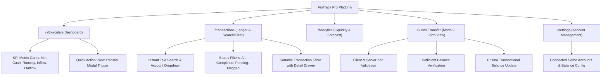

# AEGIS AI — PHASE 8C WEBSITE GENERATION BENCHMARK SPECIFICATION
**Representative Full-Stack Application Benchmark, Quality Gates & Token Budget**

- **Document Version:** 1.1.0 (Finalized Pre-Execution)
- **Target Project:** `FinTrack Pro — Demo Treasury and Cash-Flow Intelligence Platform`
- **Target Directory:** `projects/fintrack-pro`
- **Execution Mode:** Seeded Deterministic / Creative Verification
- **Framework Stack:** React + Vite + TypeScript (Frontend), Express + Node.js (Backend), Prisma + SQLite (Database), Tailwind CSS + Lucide Icons (Styling)

---

## 1. Benchmark Selection Rationale & Demo Integrity

To prove and stress-test the real-world generation capabilities of Aegis AI without consuming wasteful tokens across multiple full-website attempts, we specify **ONE** comprehensive, high-value benchmark application:

### Why "FinTrack Pro"?
1. **Multi-View Information Architecture:** It exercises four core navigation pages (Executive Dashboard, Transaction Ledger, Liquidity Analytics, System Settings) plus an interactive transfer modal.
2. **Dense Data Interaction:** Requires real-time search, multi-criteria filtering (by status, account, category), sorting, and interactive data visualization.
3. **High-Fidelity Form Validation:** Requires complex form submission with client-side constraint checking (e.g. positive amounts, non-identical source and destination accounts, mandatory reference notes) and server-side persistence.
4. **Relational Database & Transactional Persistence:** Requires a persistent SQLite database modeled with Prisma (`Account`, `Transaction`, `BudgetCategory`) and REST endpoints supporting full CRUD operations.
5. **Fictional Demo Data & Safe Transfers:** All accounts, transactions, balances, and transfers must be fictional demo data. Transfers must update the demo database transactionally (`prisma.$transaction`) without any real banking integration.
6. **Multi-Viewport Responsiveness:** Demands responsive layout handling across mobile (375px), tablet (768px), and desktop (1440px) with collapsible navigation.
7. **Complete State Coverage:** Every view must handle loading states, empty collection states, success toasts, and error boundaries.
8. **Commercial Aesthetic Coherence:** Prevents generic template convergence by demanding a professional financial interface with high contrast (WCAG AA compliant).

---

## 2. Benchmark Prompt Specification

```text
"Create FinTrack Pro, a modern enterprise treasury and cash-flow intelligence platform. It features an executive cash-flow dashboard with liquidity metrics and burn-rate charts, an interactive transaction ledger with real-time text search, multi-criteria category/account filtering, and sorting, a funds transfer modal with strict validation (source account, destination account, amount > 0, currency, reference note), a liquidity forecasting view, and a settings/account management page. Connect to a full-stack Express backend with a SQLite Prisma database for Accounts, Transactions, and Budgets, with full CRUD REST API endpoints."
```

---

## 3. Required Pages & Information Architecture



### Page Specifications
1. **Executive Dashboard (`/`):**
   - KPI metric cards: Total Treasury Balance, 30-Day Inflow, 30-Day Outflow, Net Burn Rate.
   - Interactive trend chart (SVG or Canvas) displaying 6-month historical liquidity.
   - Recent activity feed showing latest 5 ledger transactions with status badges.
   - Empty, loading, and populated states.
2. **Transaction Ledger (`/transactions`):**
   - Live text search across payee, description, and reference numbers.
   - Category filtering (Payroll, Infrastructure, SaaS Revenue, Advisory).
   - Status filtering buttons (`All`, `Completed`, `Pending`, `Flagged`).
   - Clickable table rows that open a detail inspection drawer with transaction metadata.
   - Empty state when search or filter returns zero matches.
3. **Liquidity Analytics (`/analytics`):**
   - 90-day predictive cash-flow forecasting scenario planner.
   - Monthly budget variance progress bars by department.
4. **Funds Transfer Modal / Flow (`/transfers` or Modal View):**
   - Form fields: Source Account (select), Destination Account (select), Amount (numeric > 0), Transfer Category (select), Reference Note (text $\ge 5$ chars).
   - Validation: Source $\neq$ Destination; Amount $\le$ Source Balance.
   - Transactional execution: Backend decrements source account balance and increments destination account balance inside `prisma.$transaction`.
   - UI states: Disabled submit while invalid, loading spinner during POST, success toast notification, form reset on complete.
5. **Settings & Treasury Config (`/settings`):**
   - List of active bank accounts and credit facilities with demo balances.
   - Add new account form with client/server validation.

---

## 4. Data Architecture & Database Contract

### Database Engine & Schema
- **Database Provider:** SQLite (`file:./dev.db`)
- **ORM:** Prisma 6.x
- **Schema Location:** `prisma/schema.prisma`

```prisma
datasource db {
  provider = "sqlite"
  url      = "file:./dev.db"
}

generator client {
  provider = "prisma-client-js"
}

model Account {
  id            String        @id @default(cuid())
  accountNumber String        @unique
  name          String
  type          String        // OPERATING, TREASURY, ESCROW, PAYROLL
  currency      String        @default("USD")
  balance       Float         @default(0.0)
  createdAt     DateTime      @default(now())
  updatedAt     DateTime      @updatedAt
  transactions  Transaction[]
}

model Transaction {
  id          String   @id @default(cuid())
  accountId   String
  account     Account  @relation(fields: [accountId], references: [id])
  amount      Float
  type        String   // CREDIT, DEBIT, TRANSFER
  category    String   // PAYROLL, VENDOR, REVENUE, TAX, TRANSFER
  status      String   @default("COMPLETED") // COMPLETED, PENDING, FLAGGED
  description String
  reference   String?
  createdAt   DateTime @default(now())
}

model BudgetCategory {
  id          String   @id @default(cuid())
  name        String   @unique
  allocated   Float
  spent       Float    @default(0.0)
  period      String   // e.g. "2026-Q4"
  createdAt   DateTime @default(now())
}
```

### Backend REST API Contract
| Method | Endpoint | Description | Expected Status |
|---|---|---|---|
| `GET` | `/api/health` | Server and database health check | 200 OK |
| `GET` | `/api/accounts` | Retrieve list of all treasury accounts | 200 OK |
| `POST` | `/api/accounts` | Create new treasury account with validation | 201 Created |
| `GET` | `/api/transactions` | Retrieve transactions with query params (`?status=`, `?search=`) | 200 OK |
| `POST` | `/api/transactions` | Execute transfer / record ledger transaction transactionally | 201 Created |
| `GET` | `/api/budgets` | Retrieve budget allocation categories | 200 OK |

---

## 5. Responsive Design & Visual Specifications

- **Design Archetype:** Precision Financial / Technical Modern.
- **Palette Tokens:**
  - Background: Neutral Slate Dark (`#090d16`) / Light (`#f8fafc`)
  - Surface: Card Slate (`#111827`) / (`#ffffff`)
  - Primary Brand: Emerald / Mint Green (`#10b981`) for positive cash flow
  - Secondary Accent: Indigo / Cobalt (`#3b82f6`) for actions
  - Danger / Alert: Crimson (`#ef4444`) for negative variance
  - WCAG Contrast Ratio: Minimum 4.5:1 for text on surface.
- **Responsive Breakpoints Verified:**
  - **Mobile (375px):** Single column card stacks, horizontal table scroll with fixed first column or mobile card view, hamburger navigation drawer.
  - **Tablet (768px):** Two column metric grid, responsive collapsible sidebar.
  - **Desktop (1440px):** Full multi-column layout, expansive ledger table with visible detail inspector.

---

## 6. Real Provider Budget Enforcement

Enforced centrally at the provider boundary via `GenerationBudgetGuard`:

| Metric | Enforced Upper Bound | Failure Action |
|---|---|---|
| **Total Provider API Calls** | $\le 12$ calls | Throws `BudgetExceededError`, halts further calls, preserves files, returns `BLOCKED` |
| **Total Input Tokens** | $\le 75,000$ tokens | Throws `BudgetExceededError`, halts further calls, preserves files, returns `BLOCKED` |
| **Total Output Tokens** | $\le 20,000$ tokens | Throws `BudgetExceededError`, halts further calls, preserves files, returns `BLOCKED` |
| **Total Full Generations** | **1 attempt** | Prohibits repeated complete generation runs |
| **Targeted Repairs Per Stage** | $\le 2$ repairs | Circuit breaker trips; halts repair loops |
| **Provider Outage / Rate Limit** | Immediate halt | Halts immediately without retrying full generation |
| **Telemetry Tracking** | Measured vs Estimated | Actual provider token usage tracked strictly separated from counterfactual savings |

### 6.1 Pre-Execution Budget Guard Verification Status

All budget guard controls have been verified deterministically using mocks prior to benchmark execution:

| Control Area | Control Requirement | Verified Mechanism | Status | Evidence |
|---|---|---|---|---|
| **Request Limits** | Primary provider calls counted | `guard.recordRequest()` in `FailoverProvider.chat` | **PASS** | Boundary Test 1, 7 |
| **Request Limits** | Fallback provider calls counted | Increments counter on provider switch before dispatch | **PASS** | Boundary Test 7 |
| **Request Limits** | Failed provider attempts counted | Increments before dispatch; errors recorded | **PASS** | Boundary Test 7, 8 |
| **Request Limits** | Retried requests counted | Loop iteration increments counter before each retry | **PASS** | Boundary Test 8 |
| **Request Limits** | 12-request hard ceiling | Attempt 13 throws `BudgetExceededError` | **PASS** | Boundary Test 2 |
| **Request Limits** | Zero hidden retry bypass | Provider attempt loop guarantees guard call on every try | **PASS** | Boundary Test 7, 8 |
| **Token Limits** | 75,000 max input tokens | `assertRequestAllowed(stage, promptTokens)` | **PASS** | Boundary Test 3, 4 |
| **Token Limits** | Pre-dispatch prompt estimation & rejection | Prompt evaluated via `TokenBudgetManager.estimateTokens` | **PASS** | Boundary Test 4 |
| **Token Limits** | Post-completion actual usage reconciliation | Actual tokens recorded via `MetricsTracker.logUsage` | **PASS** | Boundary Test 7, 8 |
| **Token Limits** | 20,000 max output tokens | `assertRequestAllowed`, `clampOutputTokens` | **PASS** | Boundary Test 5, 6 |
| **Token Limits** | Output allowance clamped to remaining budget | `guard.clampOutputTokens(requestedMaxTokens)` | **PASS** | Boundary Test 5 |
| **Token Limits** | Output allowance exceeding remaining budget rejected | Throws `BudgetExceededError` if requested > remaining | **PASS** | Boundary Test 6 |
| **Token Limits** | Unmetered token conservative estimation | Fallback to `TokenBudgetManager.estimateTokens` on unmetered | **PASS** | Boundary Test 9 |
| **Generation Limits** | Max 1 complete generation attempt | `assertGenerationAllowed()` / `recordGenerationStart()` | **PASS** | Unit Test 5 |
| **Repair Limits** | Max 2 targeted repairs per stage | `assertRepairAllowed(stage)` / `recordRepairAttempt` | **PASS** | Boundary Test 11 |
| **Outage & Rate Limits** | Immediate halt on outage or daily quota exhaustion | `guard.haltOnProviderOutage()` / `ProviderOutageHaltError` | **PASS** | Unit Test 6, Failover |
| **Failure Safety** | Preserve generated files on budget exhaustion | `ExecutionEngine.execute` preserves disk files | **PASS** | Boundary Test 10 |
| **Failure Safety** | Report `status: "BLOCKED"` on exhaustion | Fail-closed blocking without false claims of success | **PASS** | Boundary Test 10 |

---

## 7. Pass / Fail Acceptance Criteria (10 Quality Dimensions)

The benchmark run will be judged successful **only** when all 10 criteria pass:

1. **Design Originality:** Passes `CrossProjectSimilarityGate` with similarity score $< 0.85$; WCAG AA contrast check passes.
2. **Responsive Layouts:** Zero horizontal scrollbar overflows at 375px; mobile drawer functions; Chromium captures 3 valid screenshots.
3. **Interactive Search & Filter:** Typing in transaction search immediately filters visible rows; clicking status buttons filters ledger.
4. **Detail Inspection:** Clicking a ledger row displays the transaction metadata in an inspector panel/drawer.
5. **Form Validation & Submit:** Empty transfer form shows field errors; submitting valid transfer updates ledger and resets form.
6. **Transactional Persistence:** SQLite database migrations succeed; `GET /api/transactions` returns data; `POST /api/transactions` updates account balances transactionally.
7. **Clean Compilation:** Zero TypeScript errors (`tsc --noEmit`), zero Vite build errors (`pnpm build`).
8. **Level 1 Deterministic Verification:** `TestPyramidRunner.runLevel1DeterministicChecks` passes 100% of static checks.
9. **Final Success Gate:** `FinalSuccessGate.verify` returns `status: "SUCCESS"` with zero critical blockers.
10. **Documentation Completeness:** Generates complete `README.md` containing setup instructions, architecture breakdown, and API documentation.

---

## 8. Benchmark Execution Protocol

When user approval is granted, the benchmark will execute via:

```bash
aegis create "Create FinTrack Pro, a modern enterprise treasury and cash-flow intelligence platform. It features an executive cash-flow dashboard with liquidity metrics and burn-rate charts, an interactive transaction ledger with real-time text search, multi-criteria category/account filtering, and sorting, a funds transfer modal with strict validation (source account, destination account, amount > 0, currency, reference note), a liquidity forecasting view, and a settings/account management page. Connect to a full-stack Express backend with a SQLite Prisma database for Accounts, Transactions, and Budgets, with full CRUD REST API endpoints." --output ./projects/fintrack-pro -y
```

*All execution metrics will be recorded live by `CostObservabilityReporter` into `.aegis/cost-observability.json` and documented in `docs/phase-8/AEGIS_BENCHMARK_EXECUTION_REPORT.md`.*
